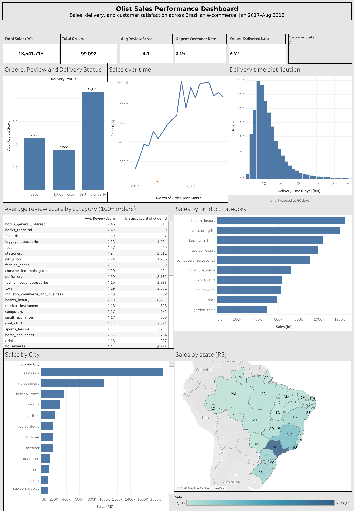
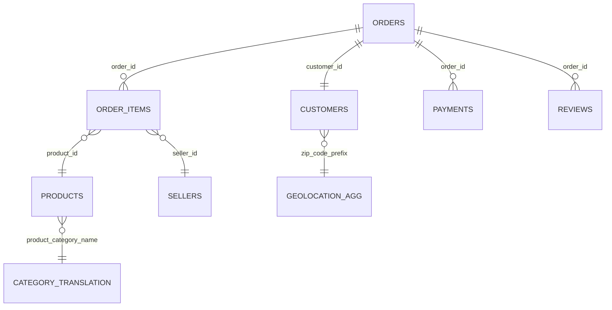

# Brazilian E-Commerce Sales Dashboard (Olist)

An interactive Tableau dashboard analysing ~100,000 orders from Olist, a Brazilian e-commerce marketplace, covering sales trends, product categories, delivery performance, customer reviews, and geographic distribution.

**🔗 Live dashboard:** https://public.tableau.com/views/OlistSalesPerformancceDashboard/OlistSalesPerformanceDashboard?:language=en-GB&:sid=&:redirect=auth&:display_count=n&:origin=viz_share_link
**📸 Preview:**



---

## Business question

Where is Olist's revenue coming from, and where are the biggest opportunities to improve — by product category, region, and delivery performance?

## Dataset

Source: [Brazilian E-Commerce Public Dataset by Olist](https://www.kaggle.com/datasets/olistbr/brazilian-ecommerce) (Kaggle)

9 relational CSV files covering orders, customers, order items, payments, reviews, products, sellers, seller/customer geolocation, and product category name translation (Portuguese → English), spanning Sept 2016 – Oct 2018.

## Data model

Tables were connected in Tableau using **relationships** (not traditional joins), which avoids row duplication (fan-out) across one-to-many tables — each table stays at its native grain until you pull specific fields into a view.



## Data cleaning

Raw files needed a few fixes before they were dashboard-ready:

| Issue | Fix |
|---|---|
| `product_category_name_translation.csv` had a hidden BOM character in its header (`\ufeffproduct_category_name`), silently breaking the join to the Products table even though the names looked identical on screen | Re-saved as plain `CSV (Comma delimited)` in Excel (not "CSV UTF-8," which actually adds the BOM back) — see `data/product_category_name_translation_fixed.csv` |
| `olist_geolocation_dataset.csv` had ~1,000,163 rows but only ~19,015 unique zip codes (up to 50+ duplicate lat/long rows per zip) — connecting it directly would have multiplied order rows | Aggregated to one row per zip code using an Excel PivotTable (lat/long averaged per zip), with city/state added back via `VLOOKUP` since those text fields can't be averaged — see `data/olist_geolocation_aggregated.csv` |
| Blank `product_category_name` on a small number of products | Calculated field: `IFNULL([Product Category Name English], "Unknown")` |
| One category name in the source data is misspelled (`costruction_tools_tools`) | Corrected for chart labels with the `Category (Display)` calculated field; the underlying data is unchanged |
| Null `order_delivered_customer_date` for canceled/undelivered orders | Kept (expected, not an error) — flagged with a calculated `Is Delivered` field rather than dropped |
| Order count differs depending on which table's `Order ID` you count: 99,441 total orders placed vs. 98,666 orders that contain at least one item (the rest were canceled before checkout) | Documented both numbers; dashboard KPI uses total orders placed, within the Jan 2017–Aug 2018 window (99,092) |
| The delivery-time histogram showed a "Null" bar for the 2,888 orders with no delivery date, which have no delivery time to plot | Removed that bar from the histogram only; these orders stay in all other views and are flagged "Not delivered" by `Delivery Status` |
| 8 orders have status "delivered" but no delivery date | Left in the "Not delivered" group for the delivery analysis, which groups by date, not status; too few to affect results |
| Product category charts were hard to scan with 70+ categories, and a top-rated ranking was dominated by tiny categories (one had only 12 orders) | The sales chart shows the Top 10 by revenue; the review chart shows only categories with at least 100 orders. Products with no listed category are grouped as "Unknown" (via the `Category (Clean)` field) rather than shown as blank/NULL |
| Sales trend line looked distorted (only 2-3 points, sharp misleading jump) because late 2016 was a sparse test-launch period with very few orders; the last month (Sept 2018) was also a partial/incomplete month of data collection, showing a misleading sharp drop | Filtered the trend chart to **Jan 2017 – Aug 2018** using a continuous, month-level date field (`DATETRUNC('month', ...)`) instead of Year, so the line reflects real, complete month-by-month activity |
| Checked `customer_city` for the same accent/spelling inconsistencies found in `geolocation_city` (e.g. "São Paulo" vs "Sao Paulo") before using it in a chart | Confirmed clean — no spelling variants found, so it was used as-is with no fix needed |
| `customer_id` is generated per order, so it can't identify repeat buyers | Used `customer_unique_id` to measure repeat purchases (`Orders per Customer` and `Repeat Customer Rate` fields); 3.1% of customers placed more than one order |
| Payments and reviews can have several rows per order, which would inflate totals if summed | Sales = sum of item `price` from Order Items (excludes freight); relationships keep payments and reviews at their own grain |
| Delivery-time outliers of several months stretched the histogram | Capped the histogram at 60 days with 2-day buckets; outliers remain in all other views |

*Note: 2,888 orders in total have no delivery date (canceled, unavailable, stuck before shipping, shipped with no delivery recorded, and the 8 marked "delivered" above). They appear as "Not delivered" in `Delivery Status`, and are hidden from the delivery-time histogram because they have no delivery time.*

## Calculated fields

- **Delivery Time (Days)** — `DATEDIFF('day', [order_purchase_timestamp], [order_delivered_customer_date])`
- **Delivery Delay (Days)** — `DATEDIFF('day', [order_estimated_delivery_date], [order_delivered_customer_date])`
- **Is Delivered** — `IIF(ISNULL([Order Delivered Customer Date]), "Not Delivered", "Delivered")`
- **Is Late** — `IF ISNULL([Delivery Delay (Days)]) THEN NULL ELSEIF [Delivery Delay (Days)] > 0 THEN 1 ELSE 0 END` (averaging this field gives the share of delivered orders that arrived late; undelivered orders are NULL, so they are excluded)
- **Delivery Status** — `IF ISNULL([Delivery Delay (Days)]) THEN "Not delivered" ELSEIF [Delivery Delay (Days)] > 0 THEN "Late" ELSE "On time or early" END` (used to compare review scores across late, on-time and undelivered orders)
- **Review Sentiment** — `IF [Review Score] >= 4 THEN "Positive" ELSEIF [Review Score] = 3 THEN "Neutral" ELSE "Negative" END`
- **Order Year-Month** — `DATETRUNC('month', [order_purchase_timestamp])`
- **Category (Clean)** — `IFNULL([Product Category Name English], "Unknown")`
- **Category (Display)** — `REPLACE([Category (Clean)], "costruction", "construction")` (fixes a misspelling in the source data for chart labels)
- **Orders per Customer** — `{FIXED [Customer Unique Id] : COUNTD([Order Id])}`
- **Repeat Customer Rate** — `COUNTD(IF [Orders per Customer] > 1 THEN [Customer Unique Id] END) / COUNTD([Customer Unique Id])` (3.1% of customers placed more than one order)

## Key insights

Figures cover Jan 2017 to Aug 2018. Sales are in Brazilian reais and are the sum of item price.

- **Sales grew fast in 2017, then levelled off.** Monthly sales rose from about 100K (Jan 2017) to a peak of about 1,000K in Nov 2017, then ranged between roughly 850K and 1,000K through Aug 2018.
- **Late delivery is linked to much worse reviews.** 6.8% of delivered orders (6,532 of 96,204) arrived after the estimated date. They average 2.27 stars, against 4.29 for orders that arrived on time or early. A further 2,888 orders (2.9%) have no delivery date and average 1.77 stars.
- **Most delivery times are reasonable, with a long tail.** Most orders arrive within 5-15 days (peak around 8-10 days), but a meaningful share stretch out toward 30-60 days. Investigating what drives the slowest deliveries (regions, carriers or sellers) is the clearest operational opportunity.
- **Sales are spread across many categories.** The top two (health_beauty and watches_gifts) are about 9% of sales each, and the top five about 40%. No single category dominates.
- **Sales are concentrated in the Southeast.** São Paulo state is about 38% of sales, and with Rio de Janeiro and Minas Gerais about 63%. At city level, São Paulo generates roughly 1.5-2x the revenue of Rio de Janeiro, the next-closest city.
- **Reviews are strong overall, with a few weaker spots.** Among categories with at least 100 orders, average scores range from 3.63 (office_furniture, 1,267 orders) to 4.46 (books_general_interest, 511 orders), against an overall average of 4.1. The best-rated categories are small niche ones (books, food and drink), while the largest, bed_bath_table, scores 3.97. Products with no listed category (2,210 orders) score lower at 3.19.
- **Very few customers come back.** Only 3.1% of customers placed more than one order (identified by customer_unique_id, across all dates), so growth has come mainly from new customers.

## Business insights and recommendations

What the findings suggest for the marketplace. These are hypotheses to test, not proven causes.

| Insight | Evidence | Suggested action |
|---|---|---|
| Late delivery goes with much worse reviews | 6.8% of delivered orders arrived after the estimated date; they average 2.27 stars against 4.29 for orders on time or early | Make late delivery the first thing to fix: find the regions, sellers or carriers behind the slowest orders, and tighten the estimated delivery dates |
| Orders that never arrive are rated lowest | 2,888 orders (2.9%) have no delivery date and average 1.77 stars. By status: 1,097 shipped with no delivery recorded (38%), 602 unavailable (21%), 579 cancelled (20%) and 602 stuck before shipping (21%) | Investigate the shipped-but-undelivered orders (lost, or still in transit when the data was extracted?) and flag out-of-stock items before checkout |
| Sales come mostly from the Southeast | São Paulo state is about 38% of sales; with Rio de Janeiro and Minas Gerais about 63% | Keep seller coverage and delivery performance strongest in these states, and test whether other regions can be grown |
| Sales are spread across many categories | The top two categories are about 9% each; the top five about 40% | Prioritise stock and seller quality in the leading categories without depending on any single one |
| Reviews are strong overall, with a few weaker spots | Among categories with at least 100 orders, scores range from 3.63 (office_furniture) to 4.46 (books_general_interest); products with no listed category (2,210 orders) score 3.19 | Investigate the weaker categories and the listings with no category |
| Very few customers come back | 3.1% of customers placed more than one order | Test repeat-purchase incentives, since growth currently depends on new customers |
| Growth levelled off in 2018 | Monthly sales rose from about 100K (Jan 2017) to about 1,000K (Nov 2017) and have stayed at roughly 850K-1,000K since; only 3.1% of customers return | Look at acquisition and repeat purchases to restart growth, and plan inventory around the Nov 2017 spike |

**Limits:** two years of data from one marketplace; "late" counts calendar days after the estimated date; review averages are per review; category order counts overlap because one order can contain several categories; statuses with only a few orders have unreliable averages; the repeat-customer share covers all dates; reviews show association with delivery, not cause.

## Dashboard contents

- **KPI tiles:** Total Sales (R$ 13,541,713), Total Orders (99,092), Average Review Score (4.1), Repeat Customer Rate (3.1%) and Orders Delivered Late (6.8%), all scoped to Jan 2017-Aug 2018 except the repeat rate, which covers all dates
- **Orders, review and delivery status:** average review score for late, on-time-or-early and undelivered orders (bar chart), labelled with the number of orders in each group (6,532 / 89,672 / 2,888)
- **Sales over time:** monthly sales (line chart), limited to Jan 2017-Aug 2018 to exclude the sparse late-2016 test-launch period and the incomplete final month
- **Delivery time distribution:** histogram of delivery times in 2-day buckets, capped at 60 days so outliers don't skew the view
- **Average review score by category (100+ orders):** scrollable table of categories ranked by average review score, with the number of orders alongside each
- **Sales by product category:** top 10 categories by sales (bar chart)
- **Sales by city:** customer cities ranked by sales (scrollable bar chart); clicking a bar filters the rest of the dashboard to that city (via a dashboard filter action, rather than a separate dropdown — a city-level dropdown would have ~2,878 entries)
- **Sales by state:** filled map of Brazilian states shaded by sales, from R$ 7,717 to R$ 5,188,099
- **Filters:** a date range (Jan 2017-Aug 2018) applied behind the scenes to all sheets, plus an interactive Customer State filter so viewers can drill into a specific region

## Repo structure

```
├── README.md
├── screenshot.png
├── olist_sales_performance_dashboard.twbx                (Tableau packaged workbook)
└── data/
    ├── product_category_name_translation_fixed.csv   (BOM removed)
    └── olist_geolocation_aggregated.csv               (deduplicated, averaged by zip)
```

Raw source CSVs are not included in this repo due to file size — download them directly from [Kaggle](https://www.kaggle.com/datasets/olistbr/brazilian-ecommerce).

## Tools

Tableau Desktop / Tableau Public, Excel (PivotTable + VLOOKUP for geolocation aggregation; plain CSV save to fix the BOM character in the category translation file)
